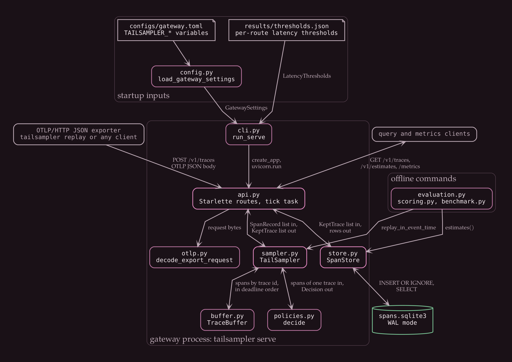
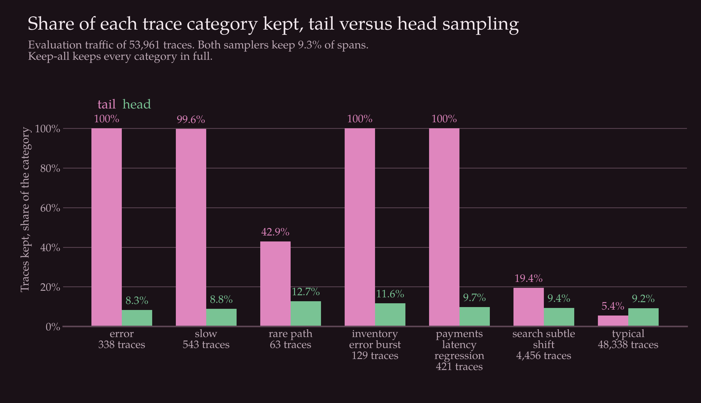
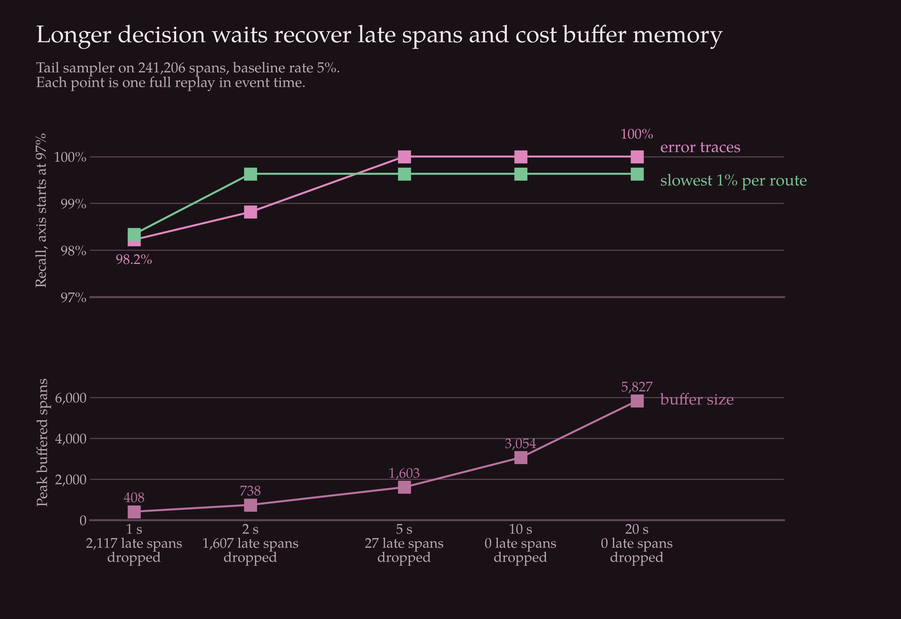

# otlp-tail-sampler

[](https://github.com/showarcase/otlp-tail-sampler/actions/workflows/ci.yml)
[](LICENSE)
[](pyproject.toml)

A tail-based trace sampler for OTLP/HTTP JSON that keeps failed and slow traces, stores a weighted sample of the rest, and comes with a replay evaluation against head sampling.

## The problem

A service fleet produces more spans than anyone wants to store. A head sampler solves that by deciding at the first span, before it knows how the request ends, so it discards failed and slow traces at the same rate as every other trace. Those are the traces an engineer opens during an incident.

A tail sampler waits until a trace is probably complete and then decides. It can keep every failure, but it has to buffer spans in memory, it has to cope with spans that arrive after the decision, and it breaks request counts, because the stored traces are no longer a random sample. This repository implements that trade in a small gateway and measures what it costs.

The person who has this problem operates a tracing pipeline and needs to know what a sampling policy keeps, what it loses and how far its counts can be trusted.

## Background

I started the project myself. Tail sampling is an established technique, and the OpenTelemetry Collector has a tail sampling processor. This repository is a separate, smaller implementation written to study the tradeoffs with ground truth, not a replacement for it.

## Architecture



*Modules inside `tailsampler serve`, the files read at startup, and the offline evaluation code that reuses the sampler and the store.*

Exporters post OTLP JSON to `api.py`, which decodes it with `otlp.py` and hands the spans to `TailSampler` in `sampler.py`. The sampler groups spans by trace id in `TraceBuffer` and holds each trace for a fixed decision wait. When the wait ends, `decide` in `policies.py` keeps the trace for an error, for a root span above its route's latency threshold, or for a hash-selected baseline share, and drops it otherwise. Kept traces carry a weight, the number of requests they stand for, and `SpanStore` writes them to SQLite. A decision cache remembers each outcome, so spans that arrive late follow the decision already made.

The query routes read the store only, and the estimates sum root span weights per route. The offline commands generate traffic, fit the thresholds and replay the traffic through three samplers. `docs/architecture.md` has the request sequence, the decision flow and the schema.

## Quick start

The project needs Python 3.13 and, to draw the diagrams, Graphviz and two font families.

```
sudo apt-get install graphviz fonts-texgyre fonts-dejavu-core
python3 -m venv .venv
source .venv/bin/activate
make setup
make data
make train
make evaluate
make diagrams
make test
```

On macOS, install Graphviz with `brew install graphviz`. `make setup` installs the project and its development tools with the versions in `requirements.lock`. `make evaluate` rewrites the tables in this file and in `docs/`, and `make test` includes a check that they are current.

## Usage

Start the gateway and send it generated traffic from a second terminal:

```
make serve
tailsampler replay --limit 2000
```

A trace is decided after `decision_wait_seconds` of real time, so wait that long before querying:

```
curl "http://127.0.0.1:4318/v1/traces?errors_only=true&limit=5"
curl http://127.0.0.1:4318/v1/estimates
curl http://127.0.0.1:4318/metrics
```

`make serve` binds to 127.0.0.1 and writes spans to `data/generated/spans.sqlite3`. Settings come from `configs/gateway.toml` and `TAILSAMPLER_*` variables, listed in `.env.example`. `docs/api.md` documents every route, and `docs/deployment.md` covers the Docker image and the CI workflow.

## Results

All numbers below come from `results/` and are copied in by `scripts/render_results.py`. The traffic is generated by `make data` from `configs/simulation.toml`: a simulated fleet with one evaluation file and one seed, and nothing is downloaded. The tail sampler, a head sampler and a keep-all reference are replayed in event time. The head sampler's rate is set to the span share the tail sampler kept, so both use the same storage.

<!-- results:begin samplers -->

| Sampler | Spans kept | Share of spans | Traces kept | Share of traces | Peak buffered spans |
| --- | ---: | ---: | ---: | ---: | ---: |
| tail | 22,472 | 9.3% | 4,626 | 8.6% | 3,054 |
| head | 22,394 | 9.3% | 4,972 | 9.2% | 0 |
| keep_all | 241,206 | 100.0% | 53,961 | 100.0% | 0 |

<!-- results:end samplers -->

Recall is the share of traces in a category that each sampler kept:

<!-- results:begin recall -->

| Trace category | Traces | tail | head | keep_all |
| --- | ---: | ---: | ---: | ---: |
| `error` | 338 | 100.0% | 8.3% | 100.0% |
| `slow` | 543 | 99.6% | 8.8% | 100.0% |
| `rare_path` | 63 | 42.9% | 12.7% | 100.0% |
| `inventory-error-burst` | 129 | 100.0% | 11.6% | 100.0% |
| `payments-latency-regression` | 421 | 100.0% | 9.7% | 100.0% |
| `search-subtle-shift` | 4,456 | 19.4% | 9.4% | 100.0% |
| `typical` | 48,338 | 5.4% | 9.2% | 100.0% |

<!-- results:end recall -->



*Share of each trace category kept by the tail and head samplers at the same span budget.*

The tail sampler keeps every failed trace and nearly every slow one. It does not keep traces that take a rare path unless they also fail or run slow, and it mostly misses the incident that adds only a small delay. For typical traces it keeps fewer than the head sampler, which is where its budget went.

Request and failure counts come from the weights:

<!-- results:begin estimate_summary -->

| Sampler | Median route error, requests | Max route error, requests | Failed requests, true | Failed requests, estimated | Max route error, failed requests |
| --- | ---: | ---: | ---: | ---: | ---: |
| tail | 2.7% | 15.0% | 338 | 338 | 0.0% |
| head | 3.1% | 7.5% | 338 | 301 | 100.0% |
| keep_all | 0.0% | 0.0% | 338 | 338 | 0.0% |

<!-- results:end estimate_summary -->

Failed requests are counted exactly. Total request counts are not better than the head sampler's at this span budget: the median route error is lower, and the worst route error is higher.



*Recall of error and slow traces, and the peak number of buffered spans, for each decision wait.*

Stage timings, measured with `perf_counter_ns` in one Python process without the HTTP layer:

<!-- results:begin benchmarks -->

| Stage | Calls | Spans | Seconds | Spans per second | p50 per call (µs) | p99 per call (µs) |
| --- | ---: | ---: | ---: | ---: | ---: | ---: |
| `decode` | 19,443 | 241,206 | 1.732 | 139,250 | 62.3 | 337.9 |
| `ingest_tail` | 19,443 | 241,206 | 0.354 | 681,439 | 12.9 | 69.0 |
| `ingest_head` | 19,443 | 241,206 | 0.076 | 3,177,846 | 3.3 | 12.3 |
| `ingest_keep_all` | 19,443 | 241,206 | 0.144 | 1,677,007 | 5.9 | 27.1 |
| `store_insert_tail` | 3,433 | 22,472 | 0.631 | 35,593 | 60.6 | 7436.8 |

<!-- results:end benchmarks -->

<!-- results:begin environment -->

| Item | Value |
| --- | --- |
| Python | CPython 3.13.18 |
| Platform | Linux-6.18.44-fc-v242-x86_64-with-glibc2.39 |
| CPU | Intel(R) Xeon(R) Processor @ 2.10GHz, 2 logical cores |
| Memory (GiB) | 7.8 |
| SQLite | 3.53.1 |
| starlette | 1.7.0 |
| uvicorn | 0.54.0 |

<!-- results:end environment -->

`docs/evaluation.md` has the method, the sweeps over decision wait and baseline rate, and the per-route estimates.

## Repository layout

```
configs/           gateway.toml, simulation.toml
docs/              architecture, data, evaluation, api and deployment notes
docs/decisions/    two short decision records
docs/diagrams/     Graphviz sources and theme.json
docs/images/       rendered diagrams and charts
results/           metrics, thresholds, benchmarks and environment written by make evaluate
scripts/           render_results.py, render_figures.py, freeze_lock.py
src/tailsampler/   the gateway, the sampler, the simulator and the evaluation code
tests/             unit tests, an end-to-end smoke test and checks on the docs and scripts
Dockerfile         image that runs tailsampler serve
Makefile           setup, data, train, evaluate, serve, test, lint, diagrams
requirements.lock  pinned versions used as a pip constraints file
```

Inside `src/tailsampler/`, `fleet.py` and `traffic.py` simulate the services, `buffer.py`, `policies.py` and `sampler.py` hold the sampling logic, `store.py` the SQLite store, `api.py` the routes, and `scoring.py`, `evaluation.py` and `benchmark.py` the evaluation.

## Design decisions

I decide inside the gateway process with a bounded buffer instead of a separate service. The cost is memory proportional to the decision wait and the span rate, and a forced early decision when the buffer is full. A restart loses the decision cache, so late spans for earlier traces start new ones.

The policy has three rules and a weight per kept trace. Failed and slow traces count once, and baseline traces count as the inverse of the baseline rate, so sums of weights stay unbiased. The price is that at a matched budget the counts are no more accurate than head sampling, and the error rule has no cap. `docs/decisions/0001-sampling-policy-and-weights.md` has the reasoning.

The baseline share is chosen by hashing the trace id instead of drawing a random number. It is reproducible and every process that sees the trace agrees. It assumes the trailing digits of the ids are uniform.

Latency thresholds are per route and fitted from calibration traffic that has no incidents. One global threshold would flag one route all the time and miss another. The thresholds are a snapshot and need `make train` again when a route's latency changes.

Kept spans go to SQLite because it needs no extra service. It has one writer and no retention, and in the benchmarks it is the slowest stage. `docs/decisions/0002-sqlite-store.md` covers it.

The gateway accepts the JSON encoding of OTLP only, which keeps the runtime dependencies to Starlette and Uvicorn. A protobuf-only exporter cannot send to it.

The evaluation replays traffic in event time instead of sleeping, so a run is quick and `metrics.json` does not depend on timing. Only `benchmarks.csv` and `environment.json` depend on the hardware.

## Limitations

- The data is simulated, with log-normal latencies and independent services. The results describe the sampler on that model, and I wrote the model and the sampler together.
- One traffic file, one seed and three incidents that each happen once.
- The policy has no rule for rare paths, and a small steady latency shift under the route threshold goes mostly undetected.
- Counts of total requests carry sampling error, and the tail sampler does not reduce it.
- The benchmarks leave out the HTTP server and were taken on one machine.
- One process, no authentication, no TLS, no store retention, and no routing by trace id for several replicas.
- No protobuf or gRPC input, and no metrics or logs.
- It has not been run against real traffic.

## Roadmap

- Decode OTLP/HTTP protobuf bodies, so standard exporters can send without a JSON option.
- Cap the error rule per route, so a failure burst cannot use the whole budget.
- Add a rule for rare operations, and an adaptive threshold that follows each route's recent latency.
- Add retention to the store and an index for the duration search.
- Evaluate on captured traces from a real service, and report how far the simulator differs from them.
- Route spans by trace id in front of several gateway replicas.

## License

MIT, see `LICENSE`.

## Acknowledgements

The traffic is generated by this repository and no external dataset is used. The OTLP JSON encoding follows the specification on opentelemetry.io. The gateway runs on Starlette and Uvicorn and stores spans with the SQLite module in the Python standard library. Tests use pytest, linting and formatting use Ruff, and the charts use Matplotlib and Pillow. The diagrams are drawn with Graphviz in TeX Gyre Pagella and DejaVu Sans Mono.
