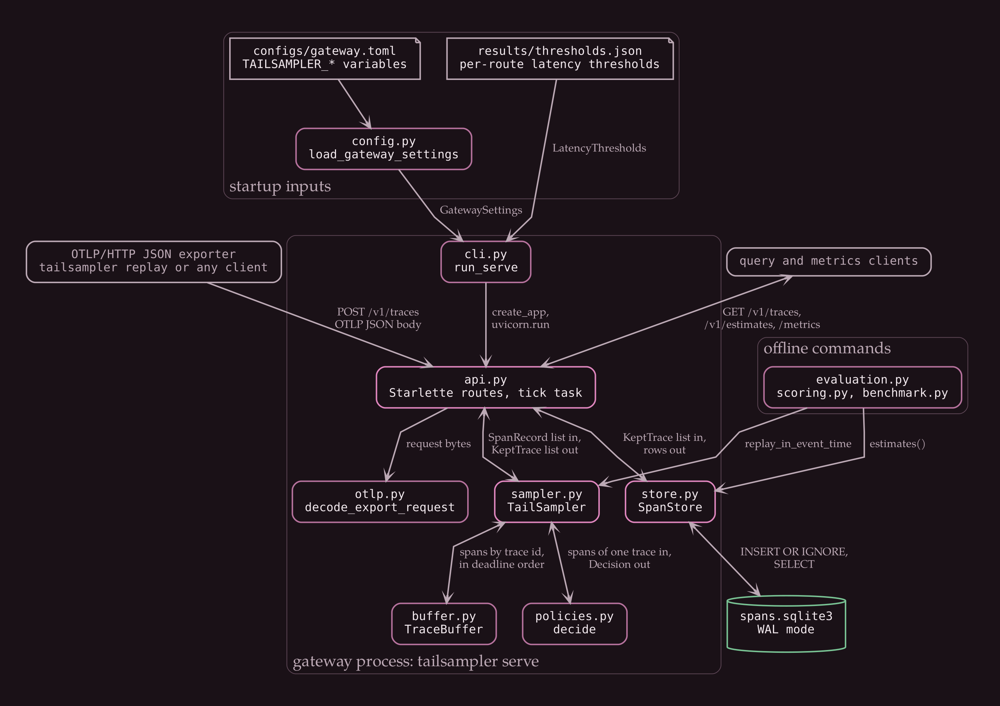
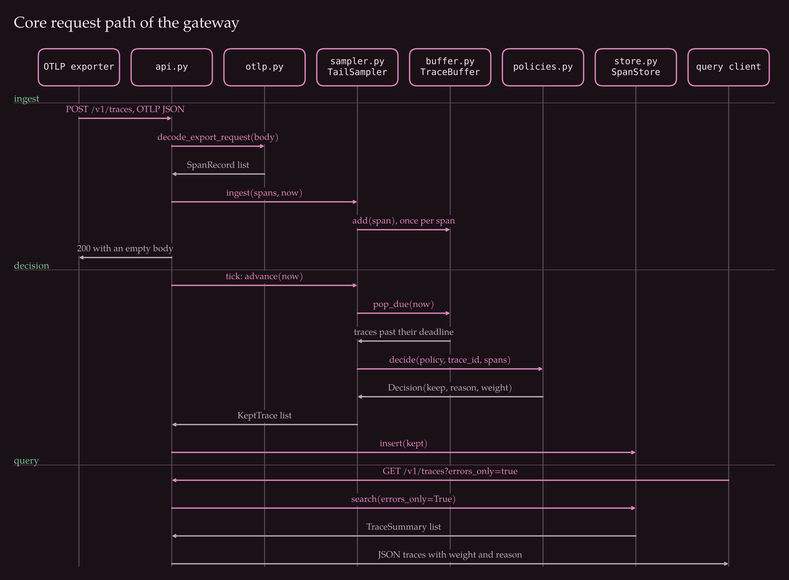
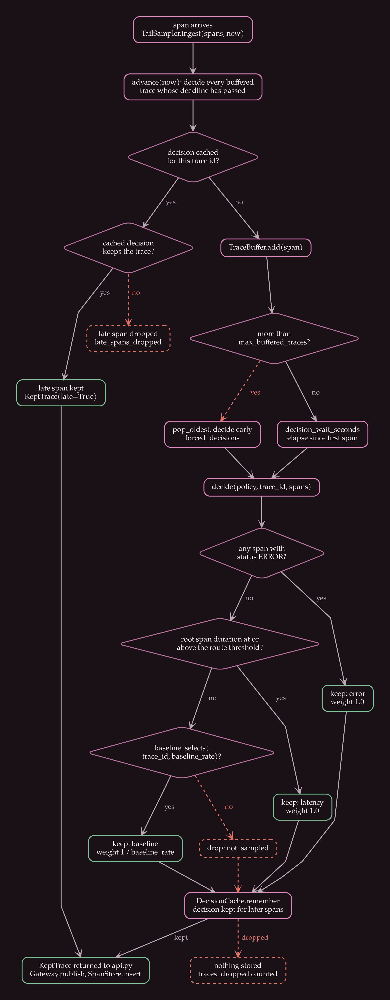
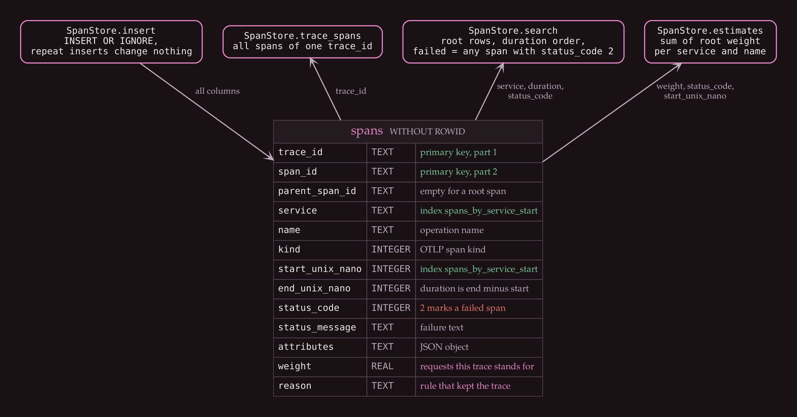
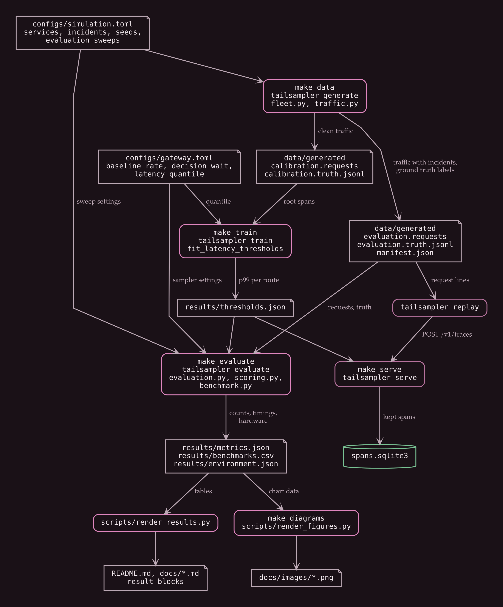

# Architecture

The gateway receives OTLP/HTTP JSON trace exports, holds spans in a bounded buffer until a trace is probably complete, decides whether to keep the trace, and stores the kept spans in SQLite together with a weight. The weight is the number of requests a stored trace stands for, so counts can be estimated from the sample.

Figure: modules inside `tailsampler serve`, the files read at startup, and the offline evaluation code that reuses the sampler and the store.

## Modules

| Module | Responsibility |
| --- | --- |
| `cli.py` | `generate`, `train`, `serve`, `replay` and `evaluate` subcommands |
| `config.py` | gateway settings from `configs/gateway.toml`, overridden by `TAILSAMPLER_*` variables |
| `api.py` | Starlette routes, the periodic tick task, Prometheus text rendering |
| `otlp.py` | decoding OTLP JSON into `SpanRecord`, and encoding it for the generated traffic |
| `model.py` | `SpanRecord`, `KeptTrace` and the sampler counters |
| `sampler.py` | `TailSampler`, the `DecisionCache`, and the head and keep-all baselines used for comparison |
| `buffer.py` | `TraceBuffer`, spans grouped by trace id in deadline order |
| `policies.py` | `decide`, the per-route latency thresholds and the trace id hash |
| `store.py` | `SpanStore`, the SQLite schema, `insert` and the read queries |
| `fleet.py`, `traffic.py` | the simulated service fleet and the traffic generator |
| `scoring.py`, `evaluation.py`, `benchmark.py` | categories, recall, estimate error, replay and timings |

## Request path

Figure: one export request from arrival to a stored trace and a later query.

`POST /v1/traces` reads the body, inflates it when the content encoding is gzip, and passes it to `decode_export_request`. The resulting `SpanRecord` list goes to `TailSampler.ingest` together with the current clock value. `ingest` first calls `advance`, which decides every trace whose deadline has passed. Each span is then either added to the buffer or, when the trace was already decided, counted as a late span.

A background task in the application calls `advance` every `tick_seconds`, so traces are decided even when no new requests arrive. Both the request handler and the tick task pass the kept traces to `Gateway.publish`, which calls `SpanStore.insert`. The sampler never touches the store.

Queries read the store only. A trace that is still in the buffer cannot be found until it has been decided and kept.

## Decision rules

Figure: what happens to a span from `TailSampler.ingest` to a stored or discarded trace.

`decide` in `policies.py` applies three rules in order to the spans of one trace:

1. A trace with any span whose status is ERROR is kept with reason `error` and weight 1.
2. A trace whose root span lasts at least as long as the threshold for its route is kept with reason `latency` and weight 1. A route has a threshold only when `make train` saw enough calibration traces for it, and a trace decided without its root span skips this rule.
3. Any other trace is kept with reason `baseline` when the last 16 hexadecimal digits of its trace id, read as a number, fall below the baseline rate times 2 to the power of 64. Its weight is 1 divided by the baseline rate. Otherwise the trace is dropped with reason `not_sampled`.

The first two rules decide on the content of the trace, so those traces count exactly once. A trace that reaches the third rule is selected with a probability equal to the baseline rate and carries a weight of 1 divided by that rate when it is. Summing weights over root spans therefore estimates the number of requests. The expected value equals the true count when each trace is decided with all of its spans, and the variance comes only from the third rule. `docs/decisions/0001-sampling-policy-and-weights.md` records the tradeoff.

The hash depends only on the trace id, so a head sampler using the same function and several gateways would agree on the baseline choice for a trace. This assumes the trailing digits of trace ids are uniformly distributed.

## Buffer, deadlines and late spans

`TraceBuffer` keeps traces in an ordered dictionary. The deadline of a trace is the time its first span arrived plus `decision_wait_seconds`, and later spans do not move it. Because traces are inserted in arrival order, deadlines are non-decreasing, and `pop_due` can stop at the first trace that is not due.

When more than `max_buffered_traces` traces are buffered, the oldest is decided immediately with the spans it has. This bounds memory but can decide a trace before its slow spans have arrived. The `forced_decisions` counter records how often it happens.

After a decision, `DecisionCache` remembers it for up to `decision_cache_size` trace ids. A span that arrives later for a kept trace is stored with the trace's reason and weight, and a span for a dropped trace is discarded. Once an id leaves the cache, a late span for it starts a new buffered trace and is decided on its own.

The buffer takes its time from the clock passed to `ingest` and `advance`. The gateway passes `time.monotonic_ns`. The evaluation passes the time each export request was sent, so a run does not wait for wall-clock time and gives the same result every time.

## Storage

Figure: the single `spans` table and the `SpanStore` methods that read or write it.

Every kept span is one row carrying the weight and reason of its trace. The primary key is `(trace_id, span_id)` and the inserts use `INSERT OR IGNORE`, so a late span adds a row and a repeated insert changes nothing. The root span of a trace is the row with an empty `parent_span_id`. `search` and `estimates` read root rows, and a trace counts as failed when any of its rows has status code 2. `docs/decisions/0002-sqlite-store.md` explains the choice of SQLite.

## Offline commands

`make data` runs `tailsampler generate`, which writes two simulated traffic files and their ground-truth labels. `make train` fits one latency threshold per route from the calibration file. `make evaluate` replays the evaluation file through the tail, head and keep-all samplers, scores them against the labels, times each stage, and writes `results/metrics.json`, `results/benchmarks.csv` and `results/environment.json`. `scripts/render_results.py` copies those files into the Markdown tables. `scripts/render_figures.py` draws the diagrams and charts.

Figure: the files each make target reads and writes.

## What the gateway does not do

It accepts the JSON encoding of OTLP only. A protobuf exporter cannot send to it, and neither gRPC nor metrics and logs are handled. Span events, links and array or map attribute values are dropped when decoding. There is one process with in-memory buffering and no authentication, and `docs/deployment.md` lists the consequences.
