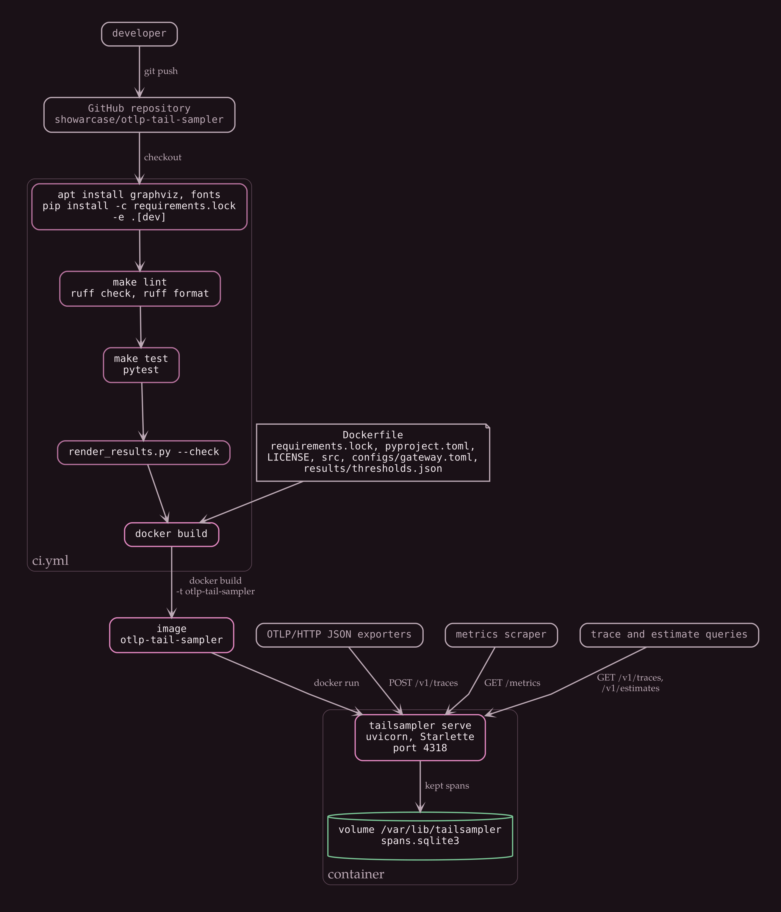

# Deployment

The gateway is one process that writes to one SQLite file. The container image runs `tailsampler serve` and nothing else. There is no compose file because there is only one service.



## Build and run

The image copies `results/thresholds.json`, so the thresholds have to exist before the build. They are written by `make train`, and `make evaluate` also writes them.

```
make train
docker build -t otlp-tail-sampler .
docker run --rm -p 4318:4318 -v tailsampler-data:/var/lib/tailsampler otlp-tail-sampler
curl http://127.0.0.1:4318/healthz
```

To send generated traffic to the container, run `make data` and then `python3 -m tailsampler.cli replay --url http://127.0.0.1:4318/v1/traces` from the repository. `replay` posts the evaluation requests as fast as the gateway accepts them. The decision wait is measured in real time with `time.monotonic_ns`, so kept traces appear in `GET /v1/traces` only after `decision_wait_seconds` has passed.

## What goes into the image

`Dockerfile` starts from `python:3.13-slim` and copies only what the gateway reads at run time: `requirements.lock`, `pyproject.toml`, `LICENSE`, `src`, `configs/gateway.toml` and `results/thresholds.json`. Tests, scripts, docs and generated data stay out, and `.dockerignore` keeps them out of the build context as well.

Only the runtime dependencies are installed. `requirements.lock` is passed to pip as a constraints file (`pip install -c requirements.lock .`), which fixes versions without installing the development packages it also lists.

The process runs as the system user `tailsampler`. The environment sets `TAILSAMPLER_HOST=0.0.0.0`, because a gateway bound to 127.0.0.1 inside a container is not reachable through a published port. It also moves the database to `/var/lib/tailsampler/spans.sqlite3`, which is declared as a volume so spans survive the container.

## Configuration

`configs/gateway.toml` holds the default for every key, and `.env.example` repeats them as variables. Each key can be overridden by an environment variable named `TAILSAMPLER_` plus the upper-cased key. `TAILSAMPLER_CONFIG` selects a different file.

| Variable | Meaning |
| --- | --- |
| TAILSAMPLER_HOST | address the server binds to |
| TAILSAMPLER_PORT | port the server binds to |
| TAILSAMPLER_DATABASE_PATH | SQLite file for kept spans |
| TAILSAMPLER_DECISION_WAIT_SECONDS | time a trace waits for more spans before it is decided |
| TAILSAMPLER_MAX_BUFFERED_TRACES | buffer capacity, the oldest trace is decided early beyond it |
| TAILSAMPLER_DECISION_CACHE_SIZE | decided trace ids remembered for late spans |
| TAILSAMPLER_BASELINE_RATE | fraction of ordinary traces kept, each carrying weight 1 / rate |
| TAILSAMPLER_LATENCY_THRESHOLDS_PATH | per-route thresholds written by `make train` |
| TAILSAMPLER_TICK_SECONDS | how often due traces are decided |
| TAILSAMPLER_LOG_LEVEL | logging level |
| TAILSAMPLER_LATENCY_QUANTILE | quantile used when fitting thresholds |
| TAILSAMPLER_MIN_CALIBRATION_SAMPLES | minimum calibration traces per route |

The last two are read by `make train`, not by `serve`.

## Lock file

`requirements.lock` is generated by `scripts/freeze_lock.py`, which walks the dependency tree of the project and its `dev` extra in the current environment and writes one `name==version` line per package. `make lock` rewrites it and `python3 scripts/freeze_lock.py --check` fails when it differs from the environment.

I generated the file on Linux with CPython 3.13. On another platform pip may need packages that the lock does not pin, such as a Windows-only dependency, and will resolve those freely.

`make setup`, the CI workflow and the Dockerfile all install with `-c requirements.lock`, so they agree on versions.

## Continuous integration

`.github/workflows/ci.yml` runs on pushes to `main` and on pull requests. It has one job on `ubuntu-latest` with Python 3.13, and runs these steps in order:

1. Install Graphviz and the two font packages the diagrams use.
2. Install the project with the `dev` extra, constrained by `requirements.lock`.
3. `make lint`, which runs `ruff check` and `ruff format --check`.
4. `make test`, which runs pytest. Tests that need Graphviz run because step 1 installed it.
5. `python3 scripts/render_results.py --check`, which fails when a results block in the Markdown files differs from what `results/` would render.
6. `docker build -t otlp-tail-sampler .`

The workflow builds the image but does not push or run it.

## Operating notes

- On shutdown the application calls `TailSampler.flush`, which decides every trace still in the buffer and writes the kept ones before the database closes.
- The buffer and the decision cache live in process memory. After a restart, a late span for a trace that was decided earlier is treated as the start of a new trace.
- Two replicas behind a load balancer would each see part of every trace unless the balancer routes by trace id. The repository does not include that routing.
- There is no authentication and no TLS. Terminate TLS in front of the gateway.
- `GET /metrics` exposes counters in the Prometheus text format, and `GET /healthz` returns `{"status":"ok"}`.
