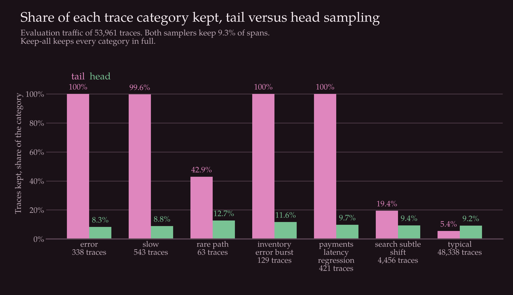
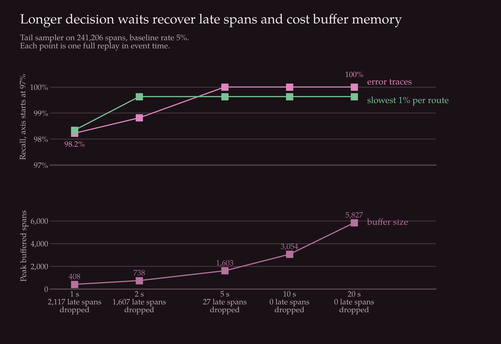
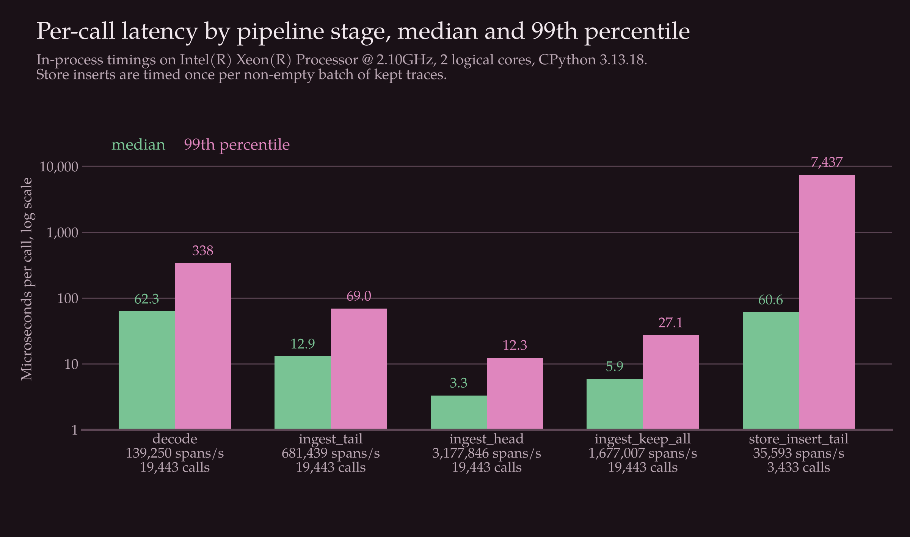

# Evaluation

The evaluation replays one generated traffic file through three samplers and scores what each keeps against the ground truth that the generator wrote. `make evaluate` runs it and writes `results/metrics.json`, `results/benchmarks.csv` and `results/environment.json`. Every table below sits between result markers and is filled in by `scripts/render_results.py`, so no figure in this file is typed by hand.

## Method

The samplers are the tail sampler, a head sampler and a keep-all reference. The head sampler keeps a trace when the hash of its trace id falls under a fixed rate, the same hash the tail sampler uses for its baseline rule. I set the head rate to the span share the tail sampler kept, so both spend the same storage budget and the comparison asks what each one buys with it.

Each export request is fed to the sampler at the time it was sent, using `replay_in_event_time`. The decision wait is therefore measured in simulated time and a run takes seconds. Spans that cross the decision deadline become late spans, as they would in the gateway.

Recall is the share of traces in a category that the sampler kept. A trace counts as kept when at least one of its spans was stored. The categories are defined in `docs/data.md`. The `complete_trace_fraction` field in `results/metrics.json` records how many kept traces have all their spans.

Request estimates come from `SpanStore.estimates`. For each route I sum the weights of the stored root spans and compare the sum with the true number of requests on that route. The error is the signed difference as a share of the true count, and the failed-request estimate uses the same weights over traces that contain a failing span. Estimates for all three samplers are computed by inserting the kept traces into an in-memory store.

Timings use `time.perf_counter_ns` around each call. A call is one export request, except for the store stage, where it is one batch of kept traces. Each stage is repeated, and the reported duration is the median of the per-repeat totals. The p50 and p99 come from the pooled per-call durations of all repeats. The timings cover decoding, the sampler's `ingest` and `SpanStore.insert`. They do not include the HTTP server, so the stage throughputs cannot be added up into a gateway throughput.

`metrics.json` does not depend on timing. Rerunning `make evaluate` gives the same file, and only `benchmarks.csv` and `environment.json` change.

## Setup

<!-- results:begin policy -->

| Setting | Value |
| --- | --- |
| baseline rate | 5% |
| decision wait (s) | 10 |
| latency threshold quantile | 0.99 |
| routes with a fitted threshold | 6 |
| head sampling rate (matched to tail span share) | 9.32% |
| slow trace definition, per route quantile | 0.99 |

<!-- results:end policy -->

The thresholds are fitted by `make train` on the calibration traffic, which has no incidents.

<!-- results:begin thresholds -->

| Route | Latency threshold (ms) | Calibration traces |
| --- | ---: | ---: |
| frontend GET / | 34.49 | 8,137 |
| frontend GET /product | 39.02 | 5,438 |
| frontend GET /search | 43.31 | 6,857 |
| frontend POST /cart | 45.52 | 2,676 |
| frontend POST /checkout | 193.96 | 2,656 |
| frontend POST /login | 11.06 | 1,309 |

<!-- results:end thresholds -->

## Which traces each sampler keeps

<!-- results:begin samplers -->

| Sampler | Spans kept | Share of spans | Traces kept | Share of traces | Peak buffered spans |
| --- | ---: | ---: | ---: | ---: | ---: |
| tail | 22,472 | 9.3% | 4,626 | 8.6% | 3,054 |
| head | 22,394 | 9.3% | 4,972 | 9.2% | 0 |
| keep_all | 241,206 | 100.0% | 53,961 | 100.0% | 0 |

<!-- results:end samplers -->

The tail sampler keeps traces for three reasons.

<!-- results:begin kept_reasons -->

| Tail keep reason | Traces kept | Share of kept traces |
| --- | ---: | ---: |
| `baseline` | 2,638 | 57.0% |
| `error` | 338 | 7.3% |
| `latency` | 1,650 | 35.7% |

<!-- results:end kept_reasons -->

Recall by category, for traces in the evaluation traffic:

<!-- results:begin recall -->

| Trace category | Traces | tail | head | keep_all |
| --- | ---: | ---: | ---: | ---: |
| `error` | 338 | 100.0% | 8.3% | 100.0% |
| `slow` | 543 | 99.6% | 8.8% | 100.0% |
| `rare_path` | 63 | 42.9% | 12.7% | 100.0% |
| `inventory-error-burst` | 129 | 100.0% | 11.6% | 100.0% |
| `payments-latency-regression` | 421 | 100.0% | 9.7% | 100.0% |
| `search-subtle-shift` | 4,456 | 19.4% | 9.4% | 100.0% |
| `typical` | 48,338 | 5.4% | 9.2% | 100.0% |

<!-- results:end recall -->

Figure: share of each trace category kept by the tail and head samplers at the same span budget.

The tail sampler keeps every error trace and nearly every slow trace, while the head sampler keeps each category at about its overall rate. That is the case for sampling after the fact. It does not extend to every kind of trace that matters.

Traces on the rare path are kept at well under half the time, because the policy has no rule for them. They are kept only when they also fail or run slow. One incident, the small shift in `search.index`, is mostly missed: the added delay is too small to lift the root span over the route threshold, so most of its traces fall through to the baseline rule. The tail sampler keeps more of them than the head sampler, because part of them lift the root span over the threshold, but most are still dropped.

## Request and failure counts

<!-- results:begin estimate_summary -->

| Sampler | Median route error, requests | Max route error, requests | Failed requests, true | Failed requests, estimated | Max route error, failed requests |
| --- | ---: | ---: | ---: | ---: | ---: |
| tail | 2.7% | 15.0% | 338 | 338 | 0.0% |
| head | 3.1% | 7.5% | 338 | 301 | 100.0% |
| keep_all | 0.0% | 0.0% | 338 | 338 | 0.0% |

<!-- results:end estimate_summary -->

The tail sampler counts failed requests exactly, since every failed trace is kept with weight 1. The head sampler underestimates them. For total requests the result is less favourable to the tail sampler. Its median route error is lower than the head sampler's, but its worst route error is higher. At a matched span budget the tail sampler spends part of the budget on error and slow traces, which leaves a lower baseline rate for the sample that estimates everything else.

<!-- results:begin estimate_routes -->

| Route | True requests | Tail estimate | Tail error | Head estimate | Head error | True failed | Tail failed | Head failed |
| --- | ---: | ---: | ---: | ---: | ---: | ---: | ---: | ---: |
| frontend GET / | 16,534 | 16,944 | +2.5% | 16,530 | 0.0% | 41 | 41 | 43 |
| frontend GET /product | 10,769 | 10,457 | -2.9% | 10,229 | -5.0% | 32 | 32 | 21 |
| frontend GET /search | 13,528 | 13,728 | +1.5% | 13,557 | +0.2% | 26 | 26 | 11 |
| frontend POST /cart | 5,219 | 4,961 | -4.9% | 4,830 | -7.5% | 15 | 15 | 0 |
| frontend POST /checkout | 5,238 | 6,024 | +15.0% | 5,581 | +6.6% | 220 | 220 | 225 |
| frontend POST /login | 2,673 | 2,634 | -1.5% | 2,640 | -1.2% | 4 | 4 | 0 |

<!-- results:end estimate_routes -->

The largest tail error is on `POST /checkout`. It is not a sign of bias. The estimator is unbiased in expectation, and the error is what the hash selection drew for that route in this file. A route with fewer baseline traces has a wider spread, and one dataset shows one draw.

## Decision wait

<!-- results:begin decision_wait_sweep -->

| Decision wait (s) | Error recall | Slow recall | Late spans dropped | Late spans kept | Peak buffered spans | Peak buffered traces |
| --- | ---: | ---: | ---: | ---: | ---: | ---: |
| 1 | 98.2% | 98.3% | 2,117 | 414 | 408 | 100 |
| 2 | 98.8% | 99.6% | 1,607 | 309 | 738 | 175 |
| 5 | 100.0% | 99.6% | 27 | 16 | 1,603 | 364 |
| 10 | 100.0% | 99.6% | 0 | 0 | 3,054 | 690 |
| 20 | 100.0% | 99.6% | 0 | 0 | 5,827 | 1,303 |

<!-- results:end decision_wait_sweep -->

Figure: recall of error and slow traces, and the peak number of buffered spans, for each decision wait.

A short wait decides traces before their slowest spans arrive, so late spans are dropped and some error traces are decided without the failing span. Recall reaches its ceiling at a wait shorter than the one that loses no late spans, because most late spans are background work that does not change the decision. A wait that loses no late spans has to be longer than the slowest exporter interval plus the network delay. A longer wait then adds only buffer size, which grows roughly in step with the wait. The default is the smallest value in the sweep that loses no late spans.

## Baseline rate

<!-- results:begin baseline_rate_sweep -->

| Tail baseline rate | Tail spans kept | Head spans kept | Tail error recall | Head error recall | Tail slow recall | Head slow recall |
| --- | ---: | ---: | ---: | ---: | ---: | ---: |
| 1% | 5.4% | 5.5% | 100.0% | 4.4% | 99.6% | 5.2% |
| 2% | 6.3% | 6.4% | 100.0% | 5.9% | 99.6% | 5.9% |
| 5% | 9.3% | 9.3% | 100.0% | 8.3% | 99.6% | 8.8% |
| 10% | 14.0% | 13.8% | 100.0% | 13.3% | 99.6% | 13.8% |

<!-- results:end baseline_rate_sweep -->

Error recall of the tail sampler does not depend on the baseline rate, since errors never reach the baseline rule. The head sampler's recall follows its rate, so even at the highest rate in the sweep it keeps only a small share of the error traces.

## Cost per stage

<!-- results:begin benchmarks -->

| Stage | Calls | Spans | Seconds | Spans per second | p50 per call (µs) | p99 per call (µs) |
| --- | ---: | ---: | ---: | ---: | ---: | ---: |
| `decode` | 19,443 | 241,206 | 1.732 | 139,250 | 62.3 | 337.9 |
| `ingest_tail` | 19,443 | 241,206 | 0.354 | 681,439 | 12.9 | 69.0 |
| `ingest_head` | 19,443 | 241,206 | 0.076 | 3,177,846 | 3.3 | 12.3 |
| `ingest_keep_all` | 19,443 | 241,206 | 0.144 | 1,677,007 | 5.9 | 27.1 |
| `store_insert_tail` | 3,433 | 22,472 | 0.631 | 35,593 | 60.6 | 7436.8 |

<!-- results:end benchmarks -->

Figure: median and 99th percentile time per call for each stage, with throughput in spans per second.

Decoding the JSON body costs more per span than the tail sampler's `ingest`. The store has the lowest throughput and the longest per-call tail, but only kept spans reach it. The tail sampler is slower than the head sampler because it buffers every span and groups spans by trace id, and the head sampler decides on each span as it arrives.

<!-- results:begin environment -->

| Item | Value |
| --- | --- |
| Python | CPython 3.13.18 |
| Platform | Linux-6.18.44-fc-v242-x86_64-with-glibc2.39 |
| CPU | Intel(R) Xeon(R) Processor @ 2.10GHz, 2 logical cores |
| Memory (GiB) | 7.8 |
| SQLite | 3.53.1 |
| starlette | 1.7.0 |
| uvicorn | 0.54.0 |

<!-- results:end environment -->

The timings were measured on the machine above. Run `make evaluate` on another machine and the table and the figure will describe that one instead.

## Limits of these results

The evaluation uses one simulated traffic file with one seed. There are three incidents and each occurs once, so the per-incident recall describes a single occurrence of each. The simulator and the sampler share my assumptions about how spans arrive, as `docs/data.md` explains. The benchmarks run in one Python process on one machine and do not include the HTTP layer.
